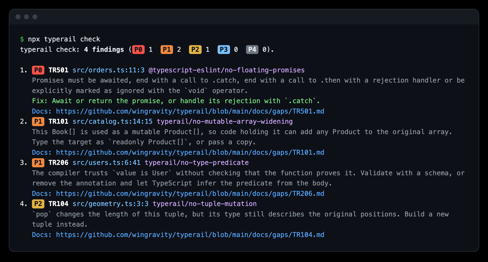

# typerail

Finds TypeScript code that type-checks and still fails at runtime.

With `strict`, `noUncheckedIndexedAccess` and `exactOptionalPropertyTypes` all on, TypeScript accepts this code without a cast, an `any` or an assertion:

```ts
const dogs: Dog[] = [rex];
const animals: Animal[] = dogs; // typerail TR101: this Dog[] is used as a mutable Animal[]
animals.push({ name: "Tom" });
const d = dogs[1];
if (d) d.bark(); // TypeError: d.bark is not a function
```

Arrays are covariant in TypeScript, so a `Dog[]` can be used as an `Animal[]`, and a plain `Animal` ends up inside it. The type system has a number of gaps like this one. typerail catalogs them, gives each a code, and reports them.

```sh
npx @wingravity/typerail check
```

- **Gaps in the type system.** Writable properties and arrays used at a wider type, method parameters checked in both directions, tuples changed by array methods, unhandled promises, and the compiler checks that `strict` leaves out.
- **Unchecked claims.** `as`, `any`, `!`, `@ts-ignore`, hand-written type predicates, overload signatures and `get<User>(url)`-style type arguments tell the compiler facts that nothing verifies. `any` from `JSON.parse` or untyped libraries does the same without anyone writing it.
- **No configuration, no way around it.** typerail brings its own compiler flags and rules. It does not change the project's `tsconfig.json` or ESLint configuration, and nothing in them, including `// eslint-disable` comments, can weaken the check.
- **Ranked by consequence.** Findings are ordered from "can stop the process" to "no runtime effect", each with a fix instruction and a link to its explanation.

typerail does not check style. Throwing or returning errors, loop forms, equality operators and truthiness checks are left to the project's own tools.

<p align="center"></p>

## Gap codes

Every gap has a code, such as TR101 for mutable array covariance, and a page that explains it: an example, why TypeScript allows it, how typerail detects it and how to fix it. [The catalog](docs/gaps/README.md) lists 36 codes, including gaps typerail documents but cannot check yet.

Each example is a test. The test suite compiles every example with TypeScript and runs it, so the catalog stays true: when a TypeScript release fixes a gap, the test names the code.

```text
1. [P1] TR102 src/cart.ts:41:12 typerail/no-mutable-property-widening
   [TR102] Property `value` is Dog here but writable as Animal through this reference ...
   Fix: Make the target's properties readonly, pass a copy, or declare the type parameter invariant (`interface Box<in out T>`).
   Docs: https://github.com/wingravity/typerail/blob/main/docs/gaps/TR102.md
```

## Quick start

```sh
npx @wingravity/typerail init
npm install
npm run typerail
```

`init` adds typerail as a dev dependency, a `typerail` script that runs `typerail check`, and instructions for coding agents. It does not touch `tsconfig.json`, the ESLint configuration or editor settings.

## Check

`typerail check` type-checks the project with typerail's compiler flags and runs typerail's rules on the files the project's tsconfig includes, following `references` in solution-style tsconfigs such as Vite's. It exits with code 1 when there are findings, so it works as a CI step.

Type information comes from the project's dependencies, so install them first. typerail stops with a message when none are installed, and warns when some are missing.

```sh
npx typerail check                      # print findings, exit 1 if there are any
npx typerail check --project tsconfig.app.json
npx typerail check --format json
npx typerail check --update-baseline    # record current findings, see below
```

The project's own compiler options are kept, such as `module`, `target`, `paths` and `lib`. typerail adds `strict`, `noUncheckedIndexedAccess`, `exactOptionalPropertyTypes` and the other flags in [the catalog](docs/gaps/README.md#compiler-flags) on top, for its own analysis only.

### Existing codebases

```sh
npx typerail check --update-baseline
```

This records the current findings in `typerail-baseline.json`, counted per file and code. Commit the file. From then on, `typerail check` fails only on findings beyond those counts, so new code must be clean while existing findings are fixed over time. When fixed findings make the baseline larger than needed, `check` says so; run `--update-baseline` again to shrink it.

## Report

`typerail report` runs the same analysis and orders every finding by the worst realistic runtime consequence of its rule, including findings in the baseline. On an existing codebase, it shows where to start.

| Priority | Meaning | Examples |
|---|---|---|
| P0: Process can go down | can stop the whole process | floating promises and async callbacks where a void callback is expected (P1 in browser code), imports that fail on Linux |
| P1: Silent wrong result | wrong data or behavior with no error raised | `as`, `any`, `Dog[]` used as a mutable `Animal[]`, bivariant methods, type predicates, non-exhaustive switches |
| P2: Request fails | throws at runtime and fails one request | possibly undefined access, `!`, `field!: T`, tuples changed by `pop`, detached methods |
| P3: Latent risk | lets through a value that later code may mishandle | `undefined` passed for an optional property |
| P4: No runtime effect | clarity only | |

```sh
npx typerail report                 # writes typerail-report.md
npx typerail report --next 20       # the 20 highest-priority findings, with fix instructions
npx typerail report --format json   # all findings as JSON
```

Production code is listed before tests, and the report lists the files with the most P0 to P2 findings. It always exits with code 0; use `typerail check` as the CI gate. Add `typerail-report.md` to `.gitignore` if it should not be committed.

## Coding agents

Coding agents such as Claude Code, Codex, Copilot and Cursor write code that compiles and passes review, and when a check fails, they often make it pass by weakening it: an `as any`, an `// eslint-disable` comment, a compiler flag set to `false`. None of these affect typerail.

- `init` adds a typerail section to `AGENTS.md`, the instruction file these agents read. It names the unchecked claims to avoid, the fixes, and the requirement that `npm run typerail` passes.
- `npx typerail report --next 20` is a short, prioritized work queue with a fix instruction for each finding.
- Every finding links to a page that explains its code, which an agent can read in `node_modules/@wingravity/typerail/docs/gaps/`.

The `AGENTS.md` section sits between `<!-- typerail:start -->` and `<!-- typerail:end -->`, and running `init` again refreshes it without touching the rest of the file. Claude Code reads `AGENTS.md` unless the project has a `CLAUDE.md`, so `init` adds an `@AGENTS.md` import to an existing `CLAUDE.md`.

## Continuous integration

For GitHub Actions, add `.github/workflows/typerail.yml`:

```yaml
name: typerail

on:
  pull_request:
  push:
    branches: [main]

jobs:
  check:
    runs-on: ubuntu-latest
    steps:
      - uses: actions/checkout@v4
      - uses: actions/setup-node@v4
        with:
          node-version: 24
          cache: npm
      - run: npm ci
      - run: npx typerail check
```

To block merging on findings, mark the job as required in the branch protection rules. For pnpm, Yarn or Bun, replace the install command.

## Editor integration

`typerail check` needs no editor setup. To see typerail's findings as you type, add its ESLint preset and tsconfig to the project; [docs/configuration.md](docs/configuration.md#editor-integration) shows how. The CLI does not depend on them.

## Requirements

Node 20.3 or later and a `tsconfig.json`. typerail brings ESLint, typescript-eslint and TypeScript as dependencies, and npm reuses the project's own copies when their versions fit: TypeScript 5.8 to 6.0, ESLint 9.35 or later, typescript-eslint 8.30 or later.

## Reference

- [docs/gaps](docs/gaps/README.md): every gap code, with an example and a fix.
- [docs/configuration.md](docs/configuration.md): which flag or rule reports each code, the rules relaxed in test files, and the optional ESLint preset.

Found code that TypeScript accepts and that fails at runtime, and typerail does not report it? [Open a missing check issue](https://github.com/wingravity/typerail/issues/new?template=missing-check.yml).

See [CONTRIBUTING.md](CONTRIBUTING.md) for development and releases.

## License

MIT
